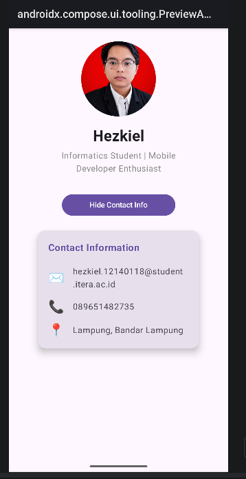
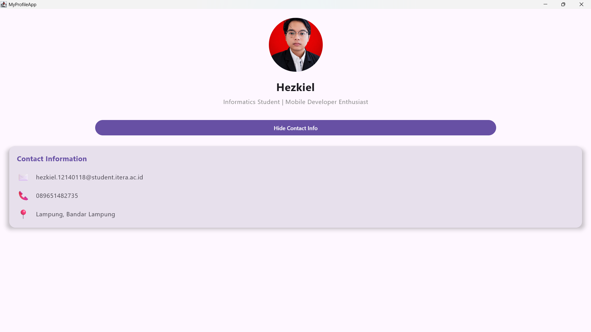

# MyProfileApp

Tugas Praktikum Pertemuan 3 — **Compose Multiplatform Layout**

## Deskripsi

Aplikasi profil sederhana yang dibuat menggunakan **Compose Multiplatform** (Kotlin). Aplikasi ini menampilkan halaman profil lengkap dengan foto, nama, bio, serta informasi kontak yang dapat ditampilkan/disembunyikan menggunakan tombol dengan efek animasi.

## Fitur

- **Halaman Profil:** Foto profil circular, nama, dan bio singkat
- **Contact Info:** Email, nomor telepon, dan lokasi
- **3 Reusable Composable Functions:**
  - `ProfileHeader` — Menampilkan foto profil, nama, dan bio
  - `ProfileCard` — Card container dengan rounded corner dan elevation
  - `InfoItem` — Baris informasi kontak (ikon + teks)
- **Komponen yang digunakan:** `Column`, `Row`, `Box`, `Card`, `Text`, `Button`, `Image`
- **Bonus:** `AnimatedVisibility` untuk animasi tampil/sembunyi pada bagian Contact Information

## Screenshot

### Mobile Preview

### Desktop Preview

## Cara Menjalankan

- **Android:** `./gradlew :androidApp:assembleDebug`
- **Desktop:**
  - Hot reload: `./gradlew :desktopApp:hotRun --auto`
  - Standard run: `./gradlew :desktopApp:run`
- **Web:**
  - Wasm: `./gradlew :webApp:wasmJsBrowserDevelopmentRun`
  - JS: `./gradlew :webApp:jsBrowserDevelopmentRun`